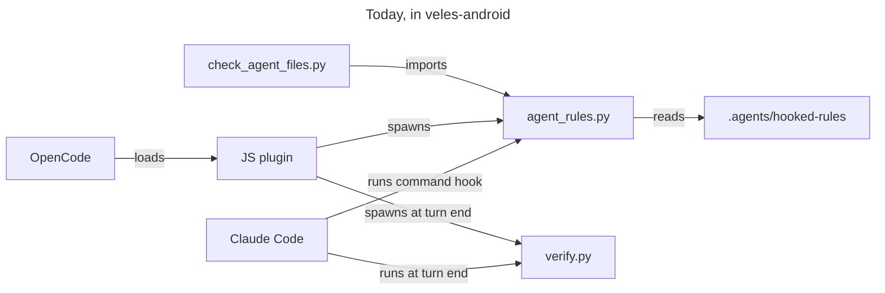
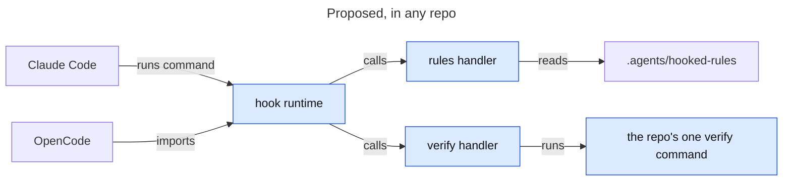
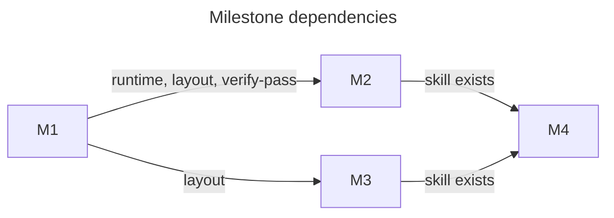

# RFC: Split the veles agent harness into separate Node skills on one shared hook runtime

| Field | Value |
|---|---|
| Status | Accepted |
| Author | Claude, drafted with the decider |
| Decider | Repository owner (raidenyn) |
| Review by | 2026-12-02 |
| Created / Updated | 2026-11-25 / 2026-11-25 |
| Links | Source harness: `veles-android` at `a86633dc`. First adopter: `line-mcp` at `a56f130`. Existing skill: [`harness-audit`](../../../../skills/harness-audit/SKILL.md) |

Reading order: [Summary](#summary) and [What changes](#what-changes) (2 min) · add [How it works today](#how-it-works-today), [Proposal](#proposal), [Contracts](#contracts), [Milestones](#milestones), [Drawbacks and risks](#drawbacks-and-risks) (10 min) · [Decisions to approve](#decisions-to-approve) last.

## Summary

The agent harness built in `veles-android` (rules delivered by hooks, a fast verifier, an instruction-file check, commit checks) is extracted into this repository as separate skills, rewritten in dependency-free Node, and copied into each repo that wants it. The audit skill becomes the entry point that decides which of them a repo needs. One shared hook runtime connects every agent host to the tools: as a command where the host runs commands, as an import where it only loads JavaScript plugins. The result is the same harness code and behavior in this repository, `veles-android` and `line-mcp`, on OpenCode and Claude Code. The work is capped at ten PRs across the three repositories. All fifteen decisions are agreed, including the three contracts.

## Problem and context

The harness exists once, inside one repository, and cannot be reused as it is.

- **It is tied to veles.** The instruction-file check holds the node files, scopes and hook commands as constants (`docs/checks/check_agent_files.py:32`, `:207`, `:109`). The verifier resolves the JDK and Android SDK (`scripts/verify.py:102`). The rule engine hard-codes OpenSpec names (`scripts/agent_rules.py:61`, `:1345`).
- **It needs two languages on OpenCode.** The engine is Python; OpenCode loads only JavaScript, so a 917-line plugin spawns the engine and handles timeouts, kills and failed injections (`scripts/opencode-hooked-rules/index.js`).
- **Other repos rebuild parts by hand.** `line-mcp` has its own Node hooks, verifier and commit checks, and no rule delivery.

The owner works agent-first in five repositories and wants one harness in all of them.

## How it works today

All paths are in `veles-android`.

- **Rule delivery.** `scripts/agent_rules.py` reads `.agents/hooked-rules/*.md` and delivers a rule's text at a skill, after a workflow command, or as a one-time denial before a gated shell command. Claude Code calls it from five hook events; OpenCode calls it through the plugin. A generated block in the root `AGENTS.md` lists every rule as a fallback.
- **Verifier.** `scripts/verify.py` takes no arguments. It reads changed files from git, maps them to parts (`.github/components.json`), runs the matching entries of `scripts/verify-commands.json` (53 commands, 7 narrowed to related tests) and skips a part whose inputs are unchanged since it passed. It runs at turn end, and `git push` is denied until it passed for HEAD (`scripts/branch_pass.py`).
- **Instruction-file check.** `docs/checks/check_agent_files.py` enforces a 40-line cap on every `AGENTS.md`, the node map, the scoped-rule grammar and the hook wiring. It imports the rule engine (`:846`).
- **Commits.** `scripts/commitlint.py`, `.githooks/commit-msg`, `.github/workflows/pr-title.yml`.



Legend: boxes are programs or folders; every arrow is a process start except "imports" and "reads".

**Prior art.** `harness-audit` detects gaps but installs nothing. A Claude Code plugin can ship hooks but does not reach CI, OpenCode or a teammate without it. `line-mcp`'s hooks cover only lint-on-edit and session context.

## Goals and non-goals

**Goals**

- This repository, `veles-android` and `line-mcp` run rule delivery and the verify gate from the same copied code, with no Python in it.
- On OpenCode and Claude Code, every capability listed in [Hook handler interface](#hook-handler-interface) is verified live.
- A turn end with no changes since the last pass costs under 300 ms (target; baseline not measured, see [Open questions](#open-questions)).
- The copied code has no npm dependencies and runs on Node 22 or newer.
- Each skill installs alone, except that rule delivery and the verify gate need the hook runtime.
- Counter-metric: hook delay per session does not rise. Today it is an estimated 9 to 17 s for a typical session (86 hook runs, measured median, at an estimated 0.1 to 0.2 s each).

**Non-goals**

- A generic engine that maps files to tests; narrowing lives behind each repo's own command.
- Gating human commits or pushes.
- Release tooling, the project-board flow, secret scanning, supply-chain checks.
- Adapters for Codex, Antigravity and Pi, and native Windows.
- A security boundary; every gate is a guardrail for cooperative agents.

## What changes

| Component | Today | Proposed | Change | Decision / milestone |
|---|---|---|---|---|
| Hook runtime | each tool wired to each host | one entry per host that calls handlers | NEW | [Shared runtime](#shared-runtime), M1 |
| Rule engine | Python plus a spawning plugin | a Node handler, imported by OpenCode | CHANGED | [Node only](#node-only), M2 |
| OpenSpec stop reminder, `opsx:` names | hard-coded | switched on by config | CHANGED | M2 |
| Proof behind a gated command | `branch-pass`: `verify.py` passed for HEAD | `verify-pass`: the verify command passed for the current tree content, registered by the verify gate | CHANGED | [Proof owner](#push-gate-owner), M2 |
| Verifier | 4,803 veles-specific lines | a wrapper around one configured command | NEW | [One command](#one-command), M1 |
| Verify triggers | turn end | file edit, ticked task, turn end | CHANGED | M1 |
| Instruction-file check | constants | Node, driven by config | CHANGED | M3 |
| Commit checks | Python validator | Node validator | CHANGED | M3 |
| `harness-audit` | detects and prioritizes | also names the fixing skill; renamed | CHANGED | [Skill names](#skill-names), M4 |
| Rule file format | `pointer`, `skills`, `commands`, `gates`, `stops`, `requires`, `exempt` | same | UNCHANGED | |
| Onboarding and update | by hand, per repo | an install and an update command in each tool, driven by a section of its skill | NEW | [Onboarding inside each skill](#onboarding), M1 |
| Codex, Antigravity, Pi | pointer block only | same | UNCHANGED | [Host order](#host-order) |
| Each repo's verifier | `verify.py`, `verify-changed.mjs` | same, called as the one command | UNCHANGED | |



Legend: blue boxes are new. "calls" is an in-process function call.

## Proposal

The audit skill stays global and decides what a repo needs. Each improvement is its own skill, carrying Node files and the steps to copy and wire them. Copied files sit in one folder of the target repo and are never edited there.

### Agreed direction

Settled in discussion on 2026-11-24 and 2026-11-25, and in review comments on 2026-11-25.

- <a id="node-only"></a>**Node only.** All copied code is plain `.mjs` with no build step. Node is already required in four of the five repositories, Python in two.
  Superseded by amendment [TypeScript source](#amend-typescript-source), see Amendments.
- <a id="vendored-copy"></a>**Vendored copy.** Code is copied into the repo, so CI, other hosts and other contributors need no install.
- <a id="placement-test"></a>**Placement test.** If a fresh clone on a CI runner or a teammate's machine lacks it and something breaks or weakens, it belongs in the repo; otherwise it stays global.
- <a id="audit-entry"></a>**Audit as the entry point.** The audit analyses the repo, prioritizes, and names the skill for each finding.
- <a id="split"></a>**Separate skills.** Improvements are split unless they form one process.
- <a id="one-command"></a>**One command.** The repo configures one verify command; the agent passes no arguments. The wrapper hashes the repo state, returns at once when that state already passed, and otherwise runs the command with the base commit and the changed-file list. The skill guides the agent to make the command fast: the test runner's own related-test support first, a hand-built mapping only where the stack has none. Three triggers run it: a file edit (lint that file), a ticked task in an OpenSpec `tasks.md`, and turn end.

- <a id="shared-runtime"></a>**Shared runtime.** A third skill owns the host wiring: one hook entry per host, calling every installed handler. That gives one process per event, one adapter per host and one place to check parity. The rejected alternative, each tool wiring itself, doubles process starts and duplicates every adapter.
- <a id="push-gate-owner"></a>**Proof owner.** The proof stays in the rule engine, as in veles: a rule gates a command and names the proof it requires. The owner's reasons: the rule text delivered with the denial can carry other instructions for that moment, so the model does not forget them at the end of a session; and the push matters less once verification happens at the commit steps, with CI as the backstop. The verify gate only registers the proof `verify-pass`. It holds for the current content of the working tree, so it is the same before and after a commit, and each repo's rule file chooses whether `git commit`, `git push` or both are gated.
- <a id="veles-switch"></a>**Three onboardings.** A milestone is done when its skill is onboarded in three repositories, in this order: this one, `veles-android`, `line-mcp`. The three onboardings are the evidence. In veles the Python copy is deleted in the same PR. In `line-mcp`, onboarding the commit checks replaces husky and npm commitlint (owner, 2026-11-25).
- <a id="host-order"></a>**Host order.** OpenCode first, Claude Code second. Codex, Antigravity and Pi are out of scope.
- <a id="pr-budget"></a>**PR budget.** At most ten PRs in total. Each milestone is therefore one PR here, carrying the skill and this repository's onboarding, plus one onboarding PR in veles and one in `line-mcp`.

### Onboarding inside each skill

<a id="onboarding"></a>Agreed on 2026-11-25. There is no separate onboarding or update skill. Each skill has an Onboard and an Update section, and each tool has `install` and `update` commands that do the mechanical part: copy the files, write the lock, merge the host's hook config without touching other entries, and refuse to overwrite a copied file that was edited. The agent does the part that needs judgement: the config values, the first rule files, trimming `AGENTS.md`. The audit reports an outdated copy and points to the Update section. The rejected alternative: one onboarding skill for all tools, which must know every tool and changes with each of them.

It is tested at three levels. Tests in this repository run `install` and `update` against throwaway git repos: a fresh install, a repeated install, an update from an older version, an edited copied file, and a host config with foreign entries. Each target repo's CI runs the tool's `check`. The three onboardings are the live test of the skill text, and because M2 and M3 change the hook runtime, onboarding them also exercises `update` in all three repos.

The three contracts below were approved as written on 2026-11-25.

Routine: the copied tools keep their tests in this repository only, as skills here ship no test code (`AGENTS.md`).

## Contracts

### Skill names

- **What it is:** naming.
- **Shape:** `agent-harness-audit` (renamed from `harness-audit`), `agent-harness-hook-runtime`, `agent-harness-hooked-rules`, `agent-harness-verify-gate`, `agent-harness-instruction-files`, `agent-harness-commits`.
- **Produced by:** M1. **Consumed by:** M2 to M4.
- **Compatibility:** a released name is never changed or reused.
- **Stability:** frozen.
- **Needs your call:** whether one prefix is worth the rename; everyone who installed `harness-audit` must reinstall. Strongest alternative: keep `harness-audit` and prefix only the new skills. A later change breaks every install of that name.

### Vendored tool layout

- **What it is:** naming and configuration.
- **Shape:**
  ```
  .agents/harness/<tool>/     copied files, never edited in the repo
  .agents/harness/lock.json   per tool: version, sha256 of each copied file
  .agents/harness.json        the repo's settings, one top-level key per tool
  ```
  Each tool has three commands: `install`, `update`, and `check`, which fails when a copied file differs from the lock; the repo's CI runs `check`.
- **Produced by:** M1. **Consumed by:** M2, M3.
- **Compatibility:** additive; a tool ignores other tools' keys and rejects unknown keys in its own.
- **Stability:** frozen.
- **Needs your call:** the names, since they land in every repo. Strongest alternative: veles's paths (`scripts/`, `docs/checks/`), which saves a move there but mixes copied and own files. A later change is a move in every repo.

### Hook handler interface

- **What it is:** interface.
- **Shape:**
  ```
  handler: { name, events, handle(event, context) -> result | null,
             proofs: { name: check(context) -> null | failure text } }
  event:   tool.before | tool.after | prompt | turn.end | compact | session.start
  result:  { deny: text } | { context: text } | { block: text }
  context: repo root, session id, agent context id, deadline, state folder
  ```
  A handler failure never blocks the host. The runtime reports a handler that needs a capability the host lacks. A handler may register named proofs; the rules handler resolves a rule's `requires` through the runtime, and the verify handler registers `verify-pass`. The capabilities, all required on OpenCode and Claude Code: deny a command before it runs; add text after a tool call; block at turn end and continue; re-deliver after compaction; separate state per subagent.
- **Produced by:** M1. **Consumed by:** M2.
- **Compatibility:** additive only.
- **Stability:** provisional until M1's live runs on both hosts, because the in-process OpenCode path is unproven.
- **Needs your call:** whether six normalized events and named proofs are the right surface. Strongest alternative: pass each host's raw event through, which puts host knowledge in every handler. A later change touches both handlers.

### Left to implementation

The pass record's format; how repo state is hashed; how files are copied; state storage and locking; the keys inside each tool's config section.

## Alternatives

Criteria, fixed before scoring: OpenCode parity, what a target repo installs, coverage of a fresh clone and CI, build cost, per-repo choice.

| Criterion | Proposed | One Python kit with config | Claude Code plugin | Do nothing |
|---|---|---|---|---|
| OpenCode parity | in-process, same code | spawning plugin stays | none | veles only |
| Installs in target repo | Node 22 | Python, plus the plugin | the plugin, per person | none |
| Fresh clone and CI | covered | covered | not covered | veles only |
| Build cost | full rewrite | about a third | small | none |
| Per-repo choice | per skill | per module | all or nothing | none |

The deciding trade-off is rewrite cost against the plugin boundary. The Python kit is the strongest runner-up: it reuses about 4,500 working lines and their live verification. It lost because every plugin-only host needs a second program that spawns the engine, and that boundary is where veles carries most of its failure handling.

### Abandoned ideas

- **The verify gate denying the push itself:** the owner kept the proof in the rule engine, so the denial carries rule text.
- **A git `pre-push` hook as the push gate:** the design is agent-first, and hooks cover it.
- **A per-component command table in every repo:** 53 hand-kept entries do not generalize.
- **A pinned npm or pip package:** an install step and a network need at hook time.
- **One installer script for all skills:** separate skills cannot share code; each tool installs itself.
- **Codex and Antigravity adapters:** dropped from scope by the owner.

## Drawbacks and risks

- **Rewrite regressions.** Trigger: a ported test passes while live behavior differs. Mitigation: port the tests first (about 9,400 lines) and repeat veles's live checks on both hosts.
- **Regex dialect.** Rule regexes move from Python to JavaScript. Trigger: a veles rule matches differently. Mitigation: M2 runs veles's rules through their existing cases.
- **No file lock in Node's standard library.** Trigger: two hook processes of one session write state at once. Mitigation: a lock built on exclusive file creation, with the existing contention tests.
- **Hard to reverse:** the published skill names, the audit rename and the vendored layout.
- **Drift between repos.** A repo keeps an old copy until updated. Mitigation: the lock records the version and the audit reports it.
- **Two verify wirings in veles.** Trigger: M2 slips after M1, so the verify gate runs from the copied code while the push proof is still veles's Python one. Mitigation: veles's Python engine and `branch-pass` stay untouched until M2 replaces both in one PR.
- **Large PRs.** Ten PRs for this scope means the rule-delivery PR alone carries the engine and about 6,400 lines of ported tests. Trigger: a review misses a regression. Mitigation: the ported tests and the three onboardings.
- **Three onboardings slow a milestone.** Trigger: one repo's onboarding is blocked by something unrelated. Mitigation: the milestone stays open and names the blocker; later milestones that do not depend on it may start.
- **Host API churn.** OpenCode's event names are those of 2.3.2. Mitigation: one adapter per host with its verified version recorded.

## Cross-cutting concerns

- **Security and privacy:** copied hooks run on every tool call, so each skill repeats veles's warning to read a checkout's hook config before starting an agent in an untrusted clone.
- **Failure behavior:** every hook passes on its own failure and tells the agent to read the rules by hand, as today.
- **Observability:** each tool's `check` and the runtime's capability report; no telemetry.
- **Migration and rollback:** per repo and per skill; rollback deletes the copied folder and its hook entries. No data is migrated.
- **Cost:** ten PRs across the three repositories, then one update per repo per release.

## Milestones

| Milestone | Outcome (what works when done) | Produces | Consumes | Depends on | Size |
|---|---|---|---|---|---|
| M1 Verify on three triggers | One configured command runs on a file edit, a ticked task and turn end, and an unchanged tree returns at once, on OpenCode and Claude Code | Skill names, Vendored tool layout, Hook handler interface | | | 3 PRs |
| M2 Rule delivery | A hooked rule is delivered at a skill, after a command and as a denial before a gated command; a gate can require `verify-pass`; the OpenSpec stop reminder works. veles runs its six rules from the copied code | | layout, interface | M1 | 3 PRs |
| M3 Instruction files and commit checks | Each repo runs one instruction-file check with its own cap, node list and `CLAUDE.md` setting, and validates commit messages and PR titles with the copied validator | | layout | M1 | 3 PRs |
| M4 Audit links and rename | The audit names the skill for each matching finding, applies the placement test, reports an outdated copy, and ships under its new name | | Skill names | M2, M3 | 1 PR |

Every outcome of M1 to M3 is shown in three repositories in order: this one, `veles-android`, `line-mcp`. Each of those milestones is three PRs: one here with the skills and this repository's onboarding, then one onboarding PR in each of the other two. An onboarding in another repository runs as its own T3 thread in that repository, started from the milestone's session, and installs the skill from the published catalog, so it also tests the install path.

M1 is the thinnest path through every new part and tests the riskiest assumption, handlers running inside OpenCode. It comes before rule delivery because the rules consume the proof it registers. M3 can run in parallel with M2.



Legend: an arrow means the right milestone needs what the label names from the left one.

## Decisions to approve

| Decision | In one sentence | Needs your call? | Status | Reason (once agreed) | Argued in |
|---|---|---|---|---|---|
| Onboarding inside each skill | No separate onboarding skill; each tool installs and updates itself | yes | agreed | No rationale given | [link](#onboarding) |
| Shared runtime | A third skill owns host wiring | yes | agreed | No rationale given | [link](#shared-runtime) |
| Skill names | Six names, one prefix, audit renamed | yes | agreed | Approved as written, no rationale given | [link](#skill-names) |
| Vendored tool layout | `.agents/harness/`, a lock, one config file | yes | agreed | Approved as written, no rationale given | [link](#vendored-tool-layout) |
| Hook handler interface | Six events, three result kinds, named proofs | yes | agreed | Approved as written, no rationale given | [link](#hook-handler-interface) |
| Proof owner | The rule engine keeps the proof; the verify gate registers it | yes | agreed | The denial's rule text carries instructions for that moment; verification belongs at commit steps, CI is the backstop | [link](#push-gate-owner) |
| Three onboardings | Each milestone is proven in this repo, veles and line-mcp, in that order | yes | agreed | Three onboardings are the evidence that a milestone is done | [link](#veles-switch) |
| Host order | OpenCode, then Claude Code; other hosts out of scope | yes | agreed | No rationale given | [link](#host-order) |
| PR budget | At most ten PRs in total | yes | agreed | No rationale given | [link](#pr-budget) |
| Node only | Copied code is dependency-free Node | routine (owner, 2026-11-25) | agreed; superseded by [TypeScript source](#amend-typescript-source) | Long-term support; OpenCode parity | [link](#node-only) |
| Vendored copy | Code is copied into each repo | routine (owner, 2026-11-24) | agreed | No rationale given | [link](#vendored-copy) |
| Placement test | In the repo if a fresh clone weakens without it | routine (owner, 2026-11-25) | agreed | "It's good framework" | [link](#placement-test) |
| Audit as entry point | The audit names the fixing skill | routine (owner, 2026-11-24) | agreed | Prioritize for the repo's own situation | [link](#audit-entry) |
| Separate skills | One skill per improvement | routine (owner, 2026-11-24) | agreed | Not every improvement fits every repo | [link](#split) |
| One command | One verify command, three triggers | routine (owner, 2026-11-25) | agreed | Agent-first, run per task, extremely fast | [link](#one-command) |

## Open questions

All are assumptions the RFC rests on; none blocks the decision.

| Question (short name) | Needs your call? | Blocks the decision? | Owner | Needed by | How it is checked |
|---|---|---|---|---|---|
| Assets in published skills | no | no | agent | M1 | Install a skill from the Pages catalog on both hosts; confirm `assets/` arrives |
| OpenCode plugin path | no | no | agent | M1 | Load the plugin from a folder under `.agents/harness/` |
| Rule regexes in JavaScript | no | no | agent | M2 | Run veles's rule cases against the Node handler |
| No-change baseline | no | no | agent | M1 | Time a no-change turn end in veles today and with the wrapper |

## Decision outcome

Accepted on 2026-11-25 by the repository owner (raidenyn), with no conditions. All fifteen decisions are agreed. The Hook handler interface stays provisional until M1's live runs on OpenCode and Claude Code. The open questions that remain are assumptions, each checked by the milestone named in its row. Work starts with the breakdown of M1 once this RFC is on the default branch.

## Review log

- **2026-11-25, direction.** The owner asked for the design after discussion. Agreed before drafting: vendored copy; the audit as entry point with separate skills; the placement test; one verify command with automatic detection and three hook triggers; Node only. Disagreement raised and closed: I first proposed a single Python kit and later a per-component command table; the owner rejected both for the reasons in the decision table.

- **2026-11-25, review comments.** Shared runtime: agreed. Push gate owner: the owner kept the proof in the rule engine; the decision is renamed Proof owner, `requires` and `exempt` stay in the rule grammar, and the handler interface gains named proofs. I had recommended the verify gate own the denial; closed in the owner's favor. Veles switch: agreed and widened to three onboardings per milestone (this repo, veles, line-mcp), renamed Three onboardings. Host order: OpenCode first, Claude Code second, rest unchanged. Resulting changes: the verify milestone moved before rule delivery because rules consume its proof; the former M1 and M2 merged into Rule delivery because veles cannot onboard without the OpenSpec parts; milestones renumbered M1 to M6.

- **2026-11-25, second round of comments.** PR budget: at most ten PRs, so each milestone became one PR here plus one onboarding PR in each other repo, and the instruction-file check and commit checks merged into one milestone. Codex and Antigravity: removed from scope with their milestone and open questions; Pi with them. Onboarding and update: the owner asked whether a separate skill is needed and how it is tested; answered in the new point Onboarding inside each skill, still proposed. Milestones renumbered M1 to M4.

- **2026-11-25, third round.** Onboarding inside each skill and its three test levels: agreed. The owner accepted the main body staying above the word cap (about 3,600 words against 2,500), so the RFC is not split.

- **2026-11-25, fourth round.** Skill names, Vendored tool layout and Hook handler interface: approved as written. The interface stays provisional until M1's live runs, as its contract says. Every decision is now agreed; the RFC itself is not yet accepted.

- **2026-11-25, acceptance.** Commit checks in line-mcp: the owner confirmed that onboarding replaces husky and npm commitlint; folded into Three onboardings and removed from the open questions. Diagrams: the owner confirmed that the three Mermaid diagrams render. The owner accepted the RFC; status set to Accepted and the folder moved to the archive.

## Amendments

- <a id="amend-typescript-source"></a>**Amendment: TypeScript source, 2026-11-25. Status: approved.** Supersedes [Node only](#node-only).
  - **New decision.** What a target repository receives does not change: plain `.mjs` with no npm dependencies, running on Node 22.0.0 or newer, with no build step in that repository. The source is TypeScript (`.mts` under `src/`) in this repository. A build here strips the types and writes the `.mjs` files into each skill's `assets/`, and the built files are committed. File names, the [Vendored tool layout](#vendored-tool-layout), the lock and every repository's hook config stay as they are.
  - **Reason (owner, 2026-11-25).** A lot of Node code is about to be written, in parallel worktrees, and it needs better checking, tests and lints; the owner asked for TypeScript as the source language.
  - **What it does not change.** The Goals line "The copied code has no npm dependencies and runs on Node 22 or newer" still holds. No contract changes. The only effect on onboarded repositories is that the next `update` brings files with a one-line "generated" header and reformatted code, under a patch version.
  - **Approved by:** the repository owner (raidenyn), 2026-11-25, wording approved as written.
  - **Implemented by:** OpenSpec change `add-typescript-build-system` (`openspec/changes/add-typescript-build-system/`).

## Appendix

**Inline spikes run**

- **Hook runs per session.** Question: how much delay do hooks add. Tested: 192 local Claude Code sessions with 20 or more tool calls, counted with the veles wiring (two runs per shell call, one per skill, file read, prompt and turn end). Result: median 86, 90th percentile 251, largest 703. Not tested: the time of a real hook event; 0.1 to 0.2 s is an estimate from the timings below.
- **Interpreter startup.** Measured on this server, 20 runs each: Python 3.14 with five standard modules 72 ms, Node 26 with three 94 ms, the veles engine's `pointers --check` 166 ms.
- **Host hook support.** Read on 2026-11-25: [Codex hooks](https://developers.openai.com/codex/hooks.md) (command hooks, deny before a tool, context after a tool, compaction events, subagent hooks use the parent session id), [Antigravity hooks](https://antigravity.google/docs/hooks) (command hooks in `.agents/hooks.json`, deny before a tool, text added only at model calls, turn-end continue), [Antigravity rules](https://antigravity.google/docs/rules), [Pi extensions](https://pi.dev/docs/latest/extensions), [OpenCode plugins](https://opencode.ai/docs/plugins/). Not tested: any live run on Codex, Antigravity or Pi.

**Line counts** (measured with `wc -l` at veles `a86633dc`): `agent_rules.py` 2,194; `opencode-hooked-rules/index.js` 917; `check_agent_files.py` 2,037; `commitlint.py` 101; `branch_pass.py` 249; `verify.py` 4,803. Tests: `test_agent_rules.py` 4,155; `index.test.mjs` 2,214; `test_check_agent_files.py` 2,715; `test_branch_pass.py` 301.

**Repositories on this server and what they need today:** `veles-android` Node and Python; `line-mcp` Node; `screen-translator` Node; `agentic-development-skills` Node and Python; `split-second` neither.
