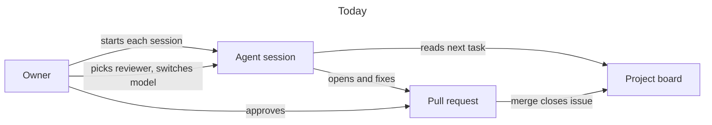
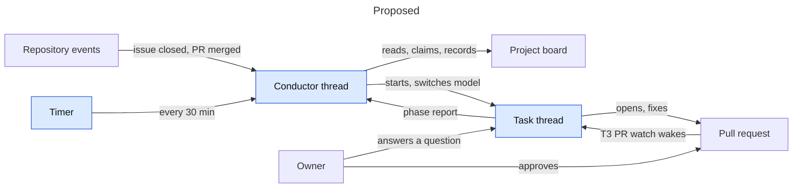
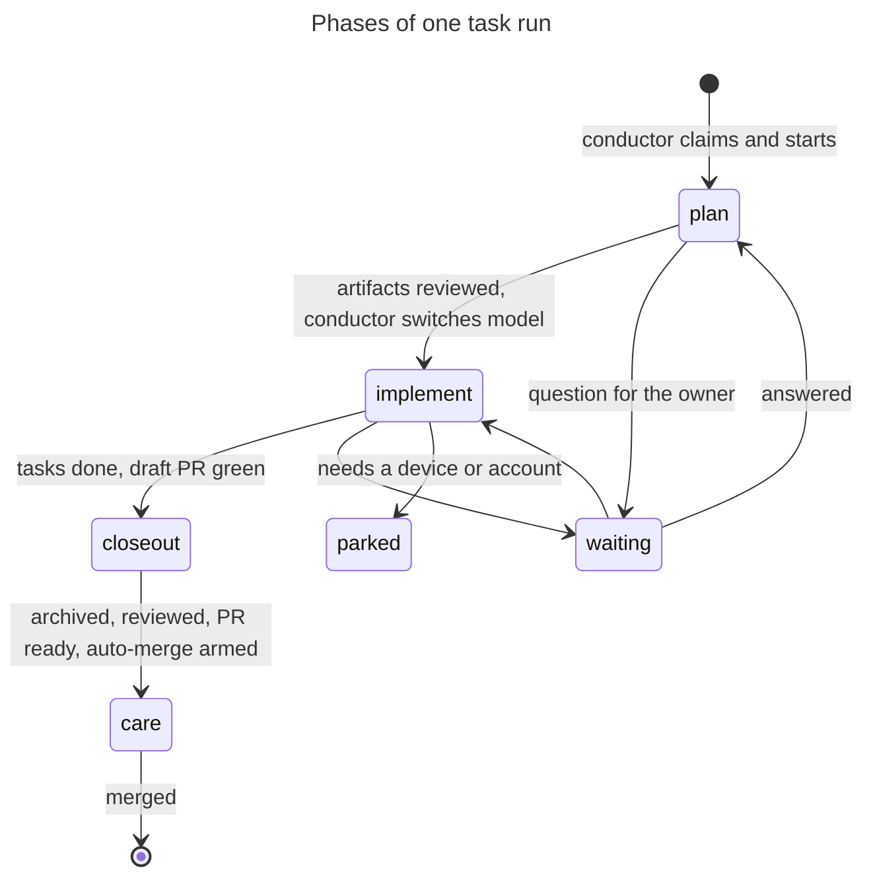
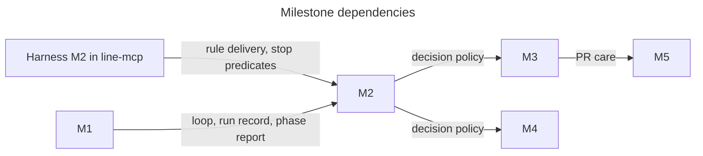

# RFC: Run the tasks of a project board unattended, from Ready to merged

| Field | Value |
|---|---|
| Status | Accepted |
| Author | Claude, drafted with the decider |
| Decider | Repository owner (raidenyn) |
| Review by | 2026-12-02 |
| Created / Updated | 2026-11-25 / 2026-11-25 |
| Links | Builds on the [agent harness RFC](../2026-11-agent-harness/rfc-split-agent-harness-into-node-skills.md). Decision records in this folder: [conductor](adr-one-conductor-thread-per-board.md), [run state](adr-keep-run-state-on-the-board.md), [model switch](adr-switch-models-once-and-start-from-files.md), [decision policy](adr-decide-by-policy-and-ask-in-the-thread.md), [schema override](adr-override-schema-stops-with-a-hooked-rule.md), [pull request flow](adr-archive-before-review-and-watch-from-the-thread.md). Evidence: [spike findings](spike-findings.md) |

Reading order: [Summary](#summary) and [What changes](#what-changes) (2 min) · add [How it works today](#how-it-works-today), [Proposal](#proposal), [Contracts](#contracts), [Milestones](#milestones), [Drawbacks and risks](#drawbacks-and-risks) (10 min) · [Decisions to approve](#decisions-to-approve) last. The decision records hold the reasoning and the rejected options.

## Summary

Once an RFC is broken down and published to a GitHub Project board, every Ready task runs to a merged pull request without the owner starting, steering or closing a session. One conductor thread per board picks the Ready tasks, starts one agent thread per task, and switches that thread from the planning model to the coding model. The owner acts in three places only: answering a question the agent may not decide, approving the pull request, and agreeing to close a milestone. All decisions are agreed; none is waiting for the owner's call.

## Problem and context

Between "task is Ready" and "pull request merged", every step waits for the owner.

- **Each task is started by hand.** In `veles-android` a session picks up one task and ends after the merge; starting the next one is out of scope by design (`openspec/changes/archive/2026-11-17-add-github-project-workflow/proposal.md`, "Session scope"). `line-mcp` and this repository have no pickup tooling.
- **Each session stops for the owner several times.** The veles review gate asks for a reviewer preset before the first review and stops after the plan to ask the owner to switch to a coding model (`.agents/hooked-rules/repo-superspec-review-gate.md`).
- **The backlog is large.** The Bank MCP board holds 36 items and the Veles OTP board 34 (measured with `gh project view`, 2026-11-25).

The owner wants development speed to stop depending on their presence.

## How it works today

- **Task flow.** All three repositories use the `superspec` OpenSpec schema: brainstorm, proposal, design, specs, tasks, plan, apply, verify, finalize (`openspec/schemas/superspec/schema.yaml`). A task file from `milestone-breakdown` is the input.
- **Board.** `task-publishing` writes issues, blocked-by links and the Status, Phase and Area fields, then stops moving Status. Veles alone derives Status and selects the next task, with `scripts/project_flow.py` (2,016 lines, measured).
- **Pull requests.** Veles's closeout opens the PR, fixes failed checks within a bound, archives the change and monitors until merge. It never merges unless the owner asks (`docs/superspec-workflow.md`).
- **Accounts and rules.** Agents push as `raidenyn-shadow`, which has write access and is not an admin; the owner approves as `raidenyn`. `line-mcp` and veles require one approval and dismiss it on a new push; this repository requires none (rules API, 2026-11-25).



Legend: boxes are actors or GitHub objects; each arrow is an action by its source.

**Prior art.** Veles's workflow covers pickup, claims, closeout and monitoring, but for one session started by a person, in Python, in one repository. T3 Code, the app that runs the agent threads, can watch a PR and wake a thread, run a task on a webhook or timer, and change a thread's model; nothing connects these to the board.

## Goals and non-goals

**Goals**

- A Ready task with no open question reaches merge with one owner action, the approval. Baseline: at least four actions per task (derived: start, reviewer choice, model switch, approval).
- A merge starts every task it unblocks, within the parallel limit, without a person.
- The owner never opens, closes or cleans up a thread or a worktree.
- A question reaches the owner once, in the task's thread, with options and a recommendation.
- Counter-metric: the share of PRs that need a second owner approval does not rise above its first-month value.

**Non-goals**

- Automating RFC writing or the first breakdown.
- Merging without the owner's approval.
- Closing a milestone without the owner (kept for now, may be relaxed).
- Guaranteeing mechanically that the reviewer read the commit that merges; out of scope for now by the owner's decision.
- Hosts other than T3 Code with Claude Code and OpenCode.
- A security boundary; the gates guide cooperative agents, as in the harness RFC.

## What changes

| Component | Today | Proposed | Change | Decision / milestone |
|---|---|---|---|---|
| Starting and claiming a task | the owner starts a session | the conductor starts a thread per Ready task | NEW | [Conductor](#conductor), M1 |
| Run state | in the session only | on the board | NEW | [Run record](#run-record), M1 |
| Model switch | by the owner | by the conductor, once per task | NEW | [Model switch](#model-switch), M1 |
| Onboarding a board | by hand | one procedure | NEW | [Onboarding](#onboarding), M1 |
| Owner stops in a task | reviewer choice, design approval, model switch | none except the [Decision policy](#decision-policy) | CHANGED | [Schema override](#schema-override), M2 |
| `superspec` schema and skills | hold the owner stops | not edited | UNCHANGED | [Schema override](#schema-override) |
| Review rounds | 5, then ask the owner | 5, then the review model fixes | CHANGED | [Model switch](#model-switch), M2 |
| Archive and auto-merge | archive after green checks; no auto-merge | archive before the PR is ready, then auto-merge | CHANGED | [PR flow](#pr-flow), M2 |
| Task size stop | stop at 1.5 times the size | no stop when unattended | CHANGED | [Decision policy](#decision-policy), M2 |
| PR care | one session, until the owner stops | the task thread, woken by T3's PR watch | CHANGED | [PR flow](#pr-flow), M3 |
| Stuck and parked work | found by the owner | found by the timer wake | NEW | M3 |
| Planning items | the owner runs and approves | run by the loop; tasks publish unasked | CHANGED | [Publish unasked](#publish-unasked), M4 |
| Milestone close | the owner agrees | prepared by the loop; the owner agrees | CHANGED | [Milestone close](#milestone-close), M4 |
| Veles's board flow | `project_flow.py` | the same loop | CHANGED | M5 |



Legend: blue boxes are new. The owner's two arrows are the only human actions in a task's run.

## Proposal

Two skills. `project-conductor` runs the loop for a board and onboards a board. `task-run` takes one task from pickup to merge. Each decision is one paragraph here; its record holds the reasoning and the rejected options.

### The loop

- <a id="conductor"></a>**Conductor.** One T3 thread per board, woken by a repository webhook (issue closed, PR merged), a task thread's phase report and a timer. Each wake is a short run with a fresh session. It repairs half-made claims, advances reported phases, then starts Ready tasks into free slots. [Record](adr-one-conductor-thread-per-board.md).
- <a id="board-reading"></a>**Board reading.** The conductor reads the board with `gh` and judges; no tool is ported. A task is Ready when it is open, unassigned, not labelled `blocked`, all its blockers are closed as completed, and its "Ready to start when" conditions are confirmed. A planning item runs the breakdown, a plan item prepares the milestone close, and an outline is never started.
- <a id="limits"></a>**Limits.** At most 2 tasks in parallel and 2 attempts per task, both settings.
- <a id="trusted-input"></a>**Trusted input.** The conductor starts only issues that carry a published task key and whose body was written by the agent account or the owner. A task thread acts only on comments and reviews from accounts with write permission. When authorship cannot be read, the answer is no.
- <a id="onboarding"></a>**Onboarding.** One procedure prepares a board: it sets `PROJECT_URL`, creates the run fields, republishes tasks that have no key, checks that the repository requires an approval, and creates the webhook. The agent account is not an admin, so when that fails it prints the exact steps for the owner. `line-mcp` is onboarded first.

### One task's run



Legend: `waiting` and `parked` free the thread's slot; `care` is the wait for checks, reviews and the merge.

- <a id="model-switch"></a>**Model switch.** One thread and one worktree per task. Opus plans, GPT-6.2 Sol reviews as a child agent, DeepSeek implements and looks after the PR. The conductor switches the thread once, and the coding model starts a fresh apply session from the saved files. Reviews run at most 5 rounds, then the review model makes the fix. [Record](adr-switch-models-once-and-start-from-files.md).
- <a id="schema-override"></a>**Schema override.** A run is unattended exactly when the conductor started it. One hooked rule per repository says what to do at each of the schema's owner stops, and a new stop predicate holds a turn open mid-phase. The schema is not edited, and a session the owner starts by hand keeps every stop. [Record](adr-override-schema-stops-with-a-hooked-rule.md).
- <a id="questions"></a>**Questions.** The task thread asks in its own T3 thread and waits; no timeout counts as consent. [Record](adr-decide-by-policy-and-ask-in-the-thread.md).
- <a id="pr-flow"></a>**PR flow.** Draft PR, green checks, archive, review of the head, ready with auto-merge, owner approval. The task thread holds T3's PR watch and fixes what it reports. [Record](adr-archive-before-review-and-watch-from-the-thread.md).
- <a id="publish-unasked"></a>**Publish unasked.** In a conductor-started run, `task-publishing` publishes a newly broken-down milestone's tasks without its approval and dry-run wait.
- <a id="milestone-close"></a>**Milestone close.** Stays with the owner for now.

## Contracts

### Decision policy

- **What it is:** the rule for when an agent decides, asks or stops, in every phase.
- **Shape:** *Decide*, and list under the PR heading "Decided without you": open choices, a contradicted assumption with an obvious fix, a healthy new dependency that replaces nothing, an additive contract extension, work beyond the task's size. *Ask in the thread:* any other dependency, an ambiguous owner comment. *Stop:* a contract's logic or compatibility must change. *Park:* a criterion needs a real device or account. Full table in the [record](adr-decide-by-policy-and-ask-in-the-thread.md).
- **Produced by:** M2. **Consumed by:** M3, M4.
- **Compatibility:** rows may be added; a row moves from Ask to Decide only by the owner.
- **Stability:** provisional until ten tasks have run, because it is drawn from discussion, not data.

### Run record

- **What it is:** data model; the durable state of one task's run, on GitHub.
- **Shape:** assignee (the claim), Status, linked branch, linked PR, the `blocked` label, three new board fields "Run phase", "Attempt" and "Run thread", and the thread title `<owner>/<repo>#<n> attempt <n>` as the launch key. Details in the [record](adr-keep-run-state-on-the-board.md).
- **Produced by:** M1. **Consumed by:** M2, M3, M4.
- **Compatibility:** options and fields may be added; a field is never renamed.
- **Stability:** provisional until M3, where recovery is its first real reader.

### Phase report

- **What it is:** interface between a task thread and the conductor.
- **Shape:** a thread message `phase-done <owner>/<repo>#<n> attempt=<n> phase=<phase> seq=<n> head=<sha>`, sent in queue mode with a fresh context. The conductor acts only when the sender is the recorded thread, attempt and phase match the Run record, `seq` is the next one, and the thread is idle. Not idle yet: retry at the next wake. Already handled: acknowledge. Anything else: stop the task and report.
- **Produced by:** M1. **Consumed by:** M2, M3.
- **Compatibility:** additive fields.
- **Stability:** provisional until M1's live run.

### Settings

- **What it is:** configuration and naming.
- **Shape:**
  ```
  skills                                           project-conductor, task-run
  repository variable PROJECT_URL                  the one board this repo serves
  .agents/harness.json  "project-conductor":       maxParallel (2), reviewRounds (5),
                                                    reconcileMinutes (30), maxAttempts (2)
  .agents/hooked-rules/repo-run-models.md          the model for each role: plan, review, implement.
                                                    Replaces repo-review-models.md where that exists
  .agents/hooked-rules/repo-unattended-run.md      the override rule of this repository
  ```
- **Produced by:** M1. **Consumed by:** M2, M3, M4.
- **Compatibility:** additive. A released name is never changed.
- **Stability:** frozen.

### Left to implementation

The wording of the conductor's instructions to a task thread; the `gh` queries; the webhook's filters; how a parked task is listed; the PR template text; the read-only restriction used for reviewers on each host.

## Alternatives

Criteria, fixed before scoring: owner actions per task, safe claims, recovery after a failure, new parts to run, build cost.

| Criterion | Proposed | Server reconciler with a ledger | GitHub Action dispatches | Do nothing |
|---|---|---|---|---|
| Owner actions per task | 1 | 1 | 1 | 4 or more (derived) |
| Safe claims | assignment, repair step, queued wakes | transactional | Action concurrency group | by hand |
| Recovery | fields on the board, timer | ledger, replay | none on the T3 side | the owner |
| New parts to run | a thread | a daemon, a store, an adapter to T3 | a workflow, plus a relay to switch models | none |
| Build cost | medium | high | medium | none |

The deciding trade-off is control against moving parts. The reconciler, proposed by a reviewer model, is the strongest runner-up: claims and phase changes become transactions that can be replayed. It lost because it still needs a thread to call T3, so it adds a daemon without removing the conductor.

### Abandoned ideas

Each decision record lists the options it rejected. Three have no record:

- **A copied Node tool for status, pickup and claims:** the owner chose to let the conductor read the board and judge.
- **Project-item webhooks as the trigger:** GitHub sends them only for organization boards.
- **Binding a review to the commit that merges:** out of scope for now.

## Drawbacks and risks

- **Half-made claim.** Trigger: a wake dies between assigning an issue and recording its thread. Mitigation: the repair step runs first in every wake and finds the thread by its launch key.
- **Lost webhook.** Trigger: the server is offline; GitHub does not retry a failed delivery. Mitigation: the timer runs even when nothing is in progress.
- **Silent waiting.** Trigger: a thread waiting on a question shows as running. Mitigation: the conductor reads each thread's pending requests, and treats a thread unchanged for longer than a set time as stuck.
- **Merge of an unreviewed fix.** Trigger: a fix is pushed while auto-merge is armed and the owner approves before the agent's own review ends. Mitigation: none in the design, by the owner's decision; the owner's approval is the check.
- **Larger PRs.** Trigger: no size stop. Mitigation: none; watched through the counter-metric.
- **Unattended spend.** Trigger: a task loops on a failing check. Mitigation: bounded fixing and the Attempt limit.
- **Instruction injection.** Trigger: a crafted issue or PR comment. Mitigation: Trusted input.
- **Hard to reverse:** the skill names and the settings names.

## Cross-cutting concerns

- **Security and privacy:** the webhook carries a signature secret; its payload is a hint and every fact is read again from GitHub.
- **Failure behavior:** a failed wake changes nothing durable that the next wake's repair step does not find.
- **Observability:** the board with its run fields, and the conductor thread's history. No telemetry.
- **Migration and rollback:** per repo; removing `PROJECT_URL` stops the conductor, and hand-started sessions keep today's stops.
- **Cost:** about 17 PRs to build (estimated). Running cost is model usage with nobody watching; not estimated. Per repo, the owner adds one webhook.

## Milestones

| Milestone | Outcome (what works when done) | Produces | Consumes | Depends on | Size | Status |
|---|---|---|---|---|---|---|
| M1 The loop, with today's stops | `line-mcp`'s board is onboarded. A merge or a timer wake makes the conductor start every Ready task within the limit, record each run on the board, switch a thread's model on its phase report, and settle merged threads. Inside a task today's owner stops remain | Run record, Phase report, Settings | | | ~5 PRs | planned |
| M2 One task, unattended | A conductor-started task in `line-mcp` runs from plan to an armed PR with no owner stop except the Decision policy, and merges after one approval | Decision policy | Run record, Phase report, Settings | M1; harness M2 in `line-mcp` | ~4 PRs | planned |
| M3 PR care and recovery | The task thread fixes conflicts, failed checks and review comments; a thread killed mid-phase resumes without duplicate work; parked tasks are reported once | | Decision policy, Run record, Phase report | M2 | ~3 PRs | planned |
| M4 Planning items | A Ready planning item runs the breakdown and publishes the tasks; a plan item prepares the milestone close and asks the owner | | Decision policy, Run record, Settings | M2 | ~3 PRs | planned |
| M5 Veles adoption | Veles's board is onboarded with keyed tasks and its own override rule, and runs through the same loop | | all four | M3 | ~2 PRs | planned |

<a id="milestone-order"></a>The loop comes first because it needs nothing from the harness RFC beyond its settings layout, so it can be built while that RFC is implemented. M2 needs the harness's rule delivery, gates and stop handling in `line-mcp` (harness M2) and its verify gate (harness M1); the new stop predicate is produced in M2 here. Harness M3 and M4 are not needed. M3 and M4 can run in parallel.



Legend: an arrow means the right milestone needs what the label names from the left one. H2 is a milestone of the harness RFC.

## Decisions to approve

| Decision | In one sentence | Needs your call? | Status | Reason (once agreed) | Argued in |
|---|---|---|---|---|---|
| Conductor | One thread per board, woken by events | yes | agreed | Kept over a server reconciler | [record](adr-one-conductor-thread-per-board.md) |
| Board reading | The conductor reads the board with `gh` and judges | yes | agreed | Chosen over a copied tool | [link](#board-reading) |
| Limits | 2 in parallel, 2 attempts, both settings | yes | agreed | No rationale given | [link](#limits) |
| Trusted input | Keyed issues by the agent or owner; writers' comments only | yes | agreed | Strictly limit and check it | [link](#trusted-input) |
| Onboarding | One procedure, with keys and the webhook; `line-mcp` first | yes | agreed | Try automatically, else give clear instructions | [link](#onboarding) |
| Model switch | One thread, switched once; a fresh session from files; 5 review rounds | yes | agreed | A fresh session on saved files is better and saves context | [record](adr-switch-models-once-and-start-from-files.md) |
| Schema override | A hooked rule and a stop predicate; unattended only when the conductor started the run | yes | agreed | A schema edit is undone by every update | [record](adr-override-schema-stops-with-a-hooked-rule.md) |
| Questions | Ask in the task's T3 thread | yes | agreed | No rationale given | [record](adr-decide-by-policy-and-ask-in-the-thread.md) |
| PR flow | Archive before ready; auto-merge; the task thread holds the PR watch | yes | agreed | PR handling is the thread's duty | [record](adr-archive-before-review-and-watch-from-the-thread.md) |
| Publish unasked | New tasks publish without approval | yes | agreed | No rationale given | [link](#publish-unasked) |
| Milestone close | The owner agrees to each close | yes | agreed | Keep for now, may relax later | [link](#milestone-close) |
| Milestone order | The loop first, the unattended run second | yes | agreed | To start on this faster | [link](#milestone-order) |
| Decision policy | The table of decide, ask, stop and park | yes | agreed | Owner's answers per row | [link](#decision-policy) |
| Run record | Run state in built-in links and three board fields | yes | agreed | Board fields over a comment | [link](#run-record) |
| Phase report | One message, checked against the record | yes | agreed | No rationale given | [link](#phase-report) |
| Settings | Two skill names, three files, one variable | yes | agreed | One model file replaces the roster | [link](#settings) |

## Open questions

| Question (short name) | Needs your call? | Blocks the decision? | Owner | Needed by | How it is checked, and what follows if it fails |
|---|---|---|---|---|---|
| Webhook signature and dedupe: do the HMAC check and the dedupe keys work as described? | no | no | agent | M1 | One signed test delivery; without it the webhook stays a hint only, as designed |
| Restart and provider failure: how does a thread look after the server restarts or a provider errors mid-turn? | no | no | agent | M3 | Cannot be staged; observed in the first runs |
| Override on the coding model: does DeepSeek follow the rule over the schema's own text, as the owner reports? | no | no | agent | M2 | One real run; if not, a pointer line goes into `openspec/config.yaml` |
| Reviewer restriction: which read-only restriction does each host offer for a child agent? | no | no | agent | M2 | Try plan mode and a restricted agent definition; if none, the reviewer is trusted |

## Decision outcome

Accepted on 2026-11-25 by the repository owner (raidenyn), with no conditions. All sixteen decisions are agreed. The Decision policy, the Run record and the Phase report stay provisional until the points their contracts name. The four open questions are checks, each made in the milestone named in its row. Work starts with the breakdown of M1 once this RFC is on the default branch.

## Review log

- **2026-11-25, direction.** The owner described the target flow and asked for a design. Agreed before drafting: Conductor (over a run per webhook and over a GitHub Action dispatcher), one thread per task switched in place, archive before review, the parallel limit, models by role, questions in the thread, Publish unasked, Milestone close kept with the owner. The owner set the Decision policy row by row. Corrected by the owner: T3 removes worktrees itself, so the conductor does not.
- **2026-11-25, reviewer model Sol.** GPT-6.2 Sol reviewed the direction once at the owner's request. Taken: a durable run record, an explicit Unattended switch, a timer that runs with nothing in progress, no auto-close on a partial delivery. Disagreement closed: Sol preferred a server reconciler; the owner kept the conductor. Sol advised against Publish unasked and for keeping Milestone close; the owner changed the first and kept the second.
- **2026-11-25, first review round.** Board tool: the owner chose reading the board with `gh` over a copied Node tool; I had recommended the tool. Renamed Board reading. First repository, a second approval after a late push, Attempt limit and Trusted input: agreed. Unattended switch: rewritten after the owner asked what it meant, then agreed as "exactly when the conductor started it".
- **2026-11-25, Run record.** The owner asked that pickup assign the task and set Status to "In progress", and whether GitHub fields could hold the run state. The record changed from an issue comment to built-in links plus three board fields; agreed.
- **2026-11-25, last contracts.** Settings: one model file replaces the existing roster; I had proposed keeping both. Phase report and the dependency row of the Decision policy: agreed. Schema override: the owner asked whether hooked rules could replace editing the schema; agreed, with `config.yaml` as a fallback pointer only.
- **2026-11-25, reviewer model Astra.** GPT-6.2 Astra reviewed the full draft. Taken: the repair step and launch key, a sequence number and sender check in the Phase report, "Ready to start when" and full pagination in Board reading, slots on resume, the body revision in Trusted input, per-repository override text. Corrected: veles's default branch is `master` and it requires one approval; my earlier note that it had no review rule was wrong.
- **2026-11-25, spikes.** The owner declined to accept before the evidence was in. Five spikes ran ([findings](spike-findings.md)). The owner then decided: a fresh apply session from saved files after the switch; PR handling stays on the task thread with T3's PR watch, and I had moved it to the conductor without asking, on a spike result that held only for delegated child agents; reviewers are trusted, with a read-only restriction where the host has one; the webhook is created automatically where possible, otherwise by clear instruction; republishing keyless tasks is part of Onboarding; binding a review to a commit is out of scope; the loop comes first. The owner asked for the document to be split, so the reasoning moved into six decision records and the findings into their own file.
- **2026-11-25, acceptance.** After the split, the owner's two approved tests ran: T3's PR watch woke a DeepSeek thread on OpenCode on a failed check, and the three run fields were created and written on a scratch board. The owner accepted the RFC; status set to Accepted and the folder moved to the archive.

## Amendments

- **2026-11-26, the conductor owns the board.** Decided by the owner, raidenyn. The reasoning is in [the change design](../../../changes/conductor-owns-the-board/design.md) (Decisions 2, 3, 4, 5 and 11a). The contract changes in five places:
  - **Settings.** A fenced block in the board readme, after the marker `<!-- project-conductor -->`, replaces `PROJECT_URL`, the `harness.json` key and `repo-run-models.md`. It holds `conductor`, `maxParallel`, `reviewRounds`, `reconcileMinutes`, `maxAttempts` and the three `model.*` lines.
  - **Model cell.** The cell is `<providerInstanceId>/<model id>#<effort>`, split at the first `/` and the last `#`. A cell with an empty part is a bare name.
  - **Conductor identity.** The conductor serves a board from any thread. Its title is `project-conductor <board URL>` and the readme `conductor` key holds its thread id. A wake writes nothing unless both agree.
  - **Onboarding.** It runs without `PROJECT_URL` and without a pull request. The conductor thread writes the readme block, the triggers and the webhook itself, and adds Repair and Settle to every wake.
  - **Task rule.** 1 task = 1 issue = 1 PR. The pull request closes its issue, and work that does not fit becomes a follow-up issue on the board.

## Appendix

Spike questions, methods and results are in [spike-findings.md](spike-findings.md).
